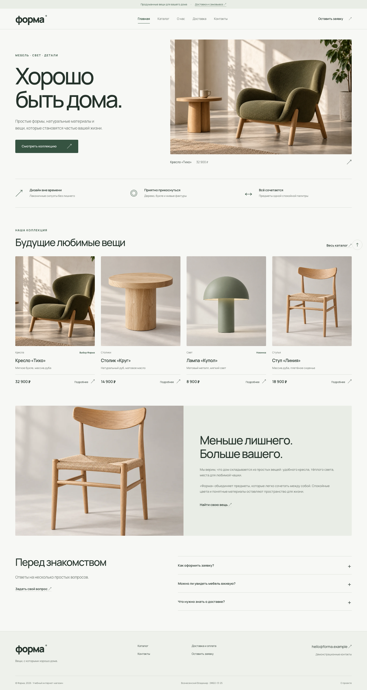

# Форма · магазин мебели и света

**Контрольная работа №1** по дисциплине «Фронтенд и бэкенд разработка».  
**Тема:** «HTML и CSS: разработка многостраничного сайта».  
**Студент:** Вознесенский Владимир. **Группа:** ЭФБО-13-25.

«Форма» — учебный интернет-магазин мебели с каталогом, отдельными страницами товаров, формой заявки и контактами. Все товары, цены, характеристики и контакты демонстрационные.



## Репозиторий и публикация

- Репозиторий: https://github.com/inedtb/front-back-mirea
- Адрес GitHub Pages после публикации: https://inedtb.github.io/front-back-mirea/
- **Статус: проект загружен в закрытый репозиторий. GitHub Pages не опубликован.** GitHub отказал во включении Pages, поскольку текущий тариф не поддерживает его для этого закрытого репозитория. По решению владельца репозиторий остаётся закрытым. Адрес Pages выше является ожидаемым адресом на будущее и сейчас не служит ссылкой на опубликованный сайт.
- Workflow `.github/workflows/pages.yml` проверяет проект при каждом push. Публикация отключена по умолчанию; для её включения нужна переменная репозитория `ENABLE_PAGES=true` и доступный GitHub Pages.

Название репозитория сохранено по ссылке студента; `kr1-html-css-shop` из методических указаний служит примером структуры.

## Просмотр проекта

Сборка, установка зависимостей и сервер приложения не требуются. Откройте `index.html` в современном браузере. Изображения и шрифты лежат в проекте, поэтому сайт работает без интернета.

Для проверки через локальный HTTP-сервер выполните из корня проекта:

```sh
python3 -m http.server 4173 --bind 127.0.0.1
```

Откройте http://127.0.0.1:4173/. Для остановки сервера нажмите `Ctrl+C`.

## Страницы

| Файл | Назначение |
| --- | --- |
| `index.html` | Главная: первый экран, преимущества, популярные товары, о магазине, FAQ |
| `catalog.html` | Каталог: категории, четыре карточки, статический макет фильтров |
| `product.html` | Кресло «Тихо»: изображение, описание, цена, таблица, заявка |
| `order.html` | Форма заявки со встроенной HTML-валидацией |
| `contacts.html` | Учебные контакты, адрес, время работы, переход к заявке |
| `product-table.html` | Столик «Круг» |
| `product-lamp.html` | Лампа «Купол» |
| `product-chair.html` | Стул «Линия» |
| `delivery.html` | Дополнительная страница доставки и самовывоза |
| `privacy.html` | Объяснение работы формы и обращения с учебными данными |
| `request-preview.html` | Завершение демонстрационного сценария заявки |

## Структура

```text
front-back-mirea/
├── index.html
├── catalog.html
├── product.html
├── product-table.html
├── product-lamp.html
├── product-chair.html
├── order.html
├── contacts.html
├── delivery.html
├── privacy.html
├── request-preview.html
├── css/style.css                 # Общие стили, переменные, адаптация, БЭМ
├── js/main.js                    # Только открытие и закрытие dialog
├── images/                       # Четыре WebP-изображения и favicon
├── fonts/                        # Manrope, локальные WOFF2 и лицензия OFL
├── docs/
│   ├── EXPLANATION.md             # Исходные задачи, реализация, план защиты
│   ├── ASSETS.md                  # Источники и промпты изображений
│   └── preview-*.png              # Снимки сайта в браузере
├── scripts/
│   ├── check_site.py              # Проверка структуры и внутренних ссылок
│   └── build_site.py              # Копирование публичных файлов в dist/
├── .github/workflows/pages.yml    # Проверка и GitHub Pages
├── .gitignore
└── README.md
```

## Технологии и решения

- HTML5: семантические `header`, `nav`, `main`, `section`, `article`, `aside`, `footer`.
- CSS3 без фреймворков: общие переменные, Flexbox, Grid, медиазапросы, БЭМ.
- Единые меню и подвал, хлебные крошки, относительные пути, ссылки на разделы.
- Нативные `details`/`summary` для FAQ; JavaScript для них не нужен.
- Нативный `<dialog>` и минимальный JavaScript для открытия/закрытия окна. Escape, удержание и возврат фокуса обеспечивает браузер. При отключённом JS ссылки открытия окна ведут к форме.
- `required`, `type="email"`, `pattern`, ограничения длины и связанные `label` для полей.
- Локальные WebP-изображения и шрифты Manrope, осмысленные `alt`, заданные размеры изображений, `loading="lazy"` для карточек.
- Тестовые Python-скрипты работают на стандартной библиотеке Python 3.9+ и не являются частью сайта. Runtime-зависимостей и сборщика JavaScript нет.

## Форма и границы реализации

Форма демонстрационная: используйте только вымышленные данные. После успешной проверки браузером открывается `request-preview.html`. Реальный заказ не создаётся, письмо не отправляется, базы данных нет.

Форма использует GET: введённые значения будут в URL и могут остаться в истории браузера и журналах хостинга. Это явно указано на странице условий. Страница результата не изображает подтверждение принятого магазином заказа.

Товар выбирается вручную в списке. Ссылка со страницы предмета ведёт к соответствующему полю формы. Автоматическая подстановка, корзина, серверная отправка и работающие фильтры оставлены для следующих работ. Фильтры в каталоге отключены и подписаны как статический макет, как предусмотрено заданием. Категории работают как якорная навигация.

## Самостоятельные доработки

1. Собственная визуальная концепция и согласованные изображения коллекции.
2. Три дополнительные страницы товаров: каждая карточка открывает свой предмет.
3. Дополнительные страницы доставки, условий формы и результата.
4. FAQ через нативные элементы без JavaScript.
5. Хлебные крошки, якорные категории каталога, фиксированная ссылка «Наверх».
6. Улучшенная доступность: переход к содержимому, видимый фокус, подписи полей, нативный dialog с возвратом фокуса, поддержка уменьшения движения.
7. Адаптивная сетка для мобильных устройств, стили печати, локальные ресурсы.
8. Проверка ссылок и воспроизводимая подготовка файлов для GitHub Pages.

Оригинальные требования и соответствующие файлы перечислены в [пояснениях к работе](docs/EXPLANATION.md).

## Проверка

```sh
python3 scripts/check_site.py
python3 scripts/build_site.py
```

Первая команда проверяет все 11 HTML-страниц: обязательные файлы, уникальные `title`, семантический каркас, единственные `main` и `h1`, подписи полей, наличие локальных ресурсов и целей якорных ссылок. Вторая собирает только публичные файлы в `dist/`.

В браузере Chromium проверены все страницы на ширинах 320, 390, 768 и 1440 px, отсутствие горизонтального переполнения, загрузка изображений, открытие/закрытие модального окна, Escape, возврат фокуса, FAQ, обязательные поля и отправка учебной формы. Отдельно проверен переход к форме при отключённом JavaScript. Скриншоты находятся в `docs/`.

## Публикация через GitHub Pages

Проект уже загружен в ветку `main`. Следующие шаги применимы только если владелец позднее решит включить публикацию. Закрытый доступ к исходникам сохранён.

1. Обеспечить доступность GitHub Pages для закрытого репозитория на используемом тарифе.
2. В репозитории открыть **Settings → Pages → Build and deployment → Source → GitHub Actions**.
3. В **Settings → Secrets and variables → Actions → Variables** создать переменную `ENABLE_PAGES` со значением `true`.
4. Запустить workflow вручную на вкладке **Actions** или отправить новый коммит в `main`. Он проверит ссылки, подготовит `dist/` и опубликует сайт. Без этой переменной выполняются только проверки и подготовка файлов.
5. После успешного deployment открыть возвращённый адрес и убедиться, что страницы доступны; обновить статус в README.
6. Предоставить преподавателю доступ к закрытому репозиторию и самостоятельно сдать ссылку в СДО.

Если имя основной ветки отличается, его нужно добавить в `on.push.branches` workflow. Для закрытого репозитория доступность GitHub Pages зависит от тарифа. Настройка основана на [официальной документации GitHub Pages](https://docs.github.com/en/pages/getting-started-with-github-pages/using-custom-workflows-with-github-pages).

Никаких действий в СДО проект автоматически не выполняет.
